<div align="center">

# rz-tablet

**Une tablette façon iPadOS pour FiveM, pensée pour le roleplay.**

Un vrai objet ox_inventory, avec ses apps, ses widgets, son centre de contrôle, son verrou et ses notifications.
Tout tourne en local : aucune librairie chargée en ligne, aucune API externe.

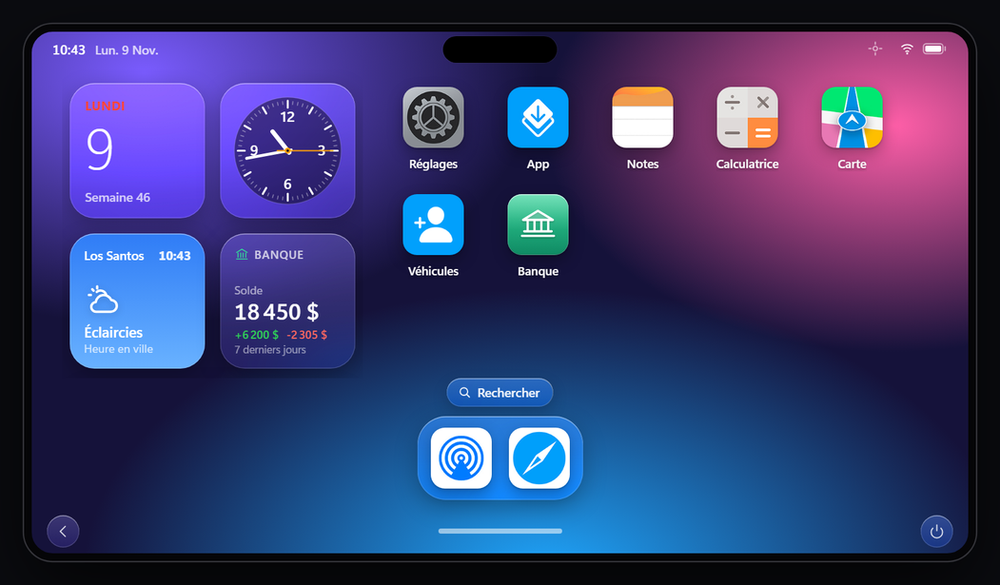

`ESX Legacy` · `ox_inventory` · `oxmysql` · `OneSync` · `Lua 5.4` · `HTML / CSS / JS sans framework` · `Licence MIT`

</div>

---

## Sommaire

- [Aperçu](#aperçu)
- [Fonctionnalités](#fonctionnalités)
- [Installation](#installation)
- [Configuration](#configuration)
- [Utilisation en jeu](#utilisation-en-jeu)
- [Pour les développeurs](#pour-les-développeurs)
- [Banc d'essai hors du jeu](#banc-dessai-hors-du-jeu)
- [Structure du dossier](#structure-du-dossier)
- [Base de données](#base-de-données)
- [Dépannage](#dépannage)
- [Crédits et licences](#crédits-et-licences)

---

## Aperçu

| Verrouillage | Notification |
|---|---|
| 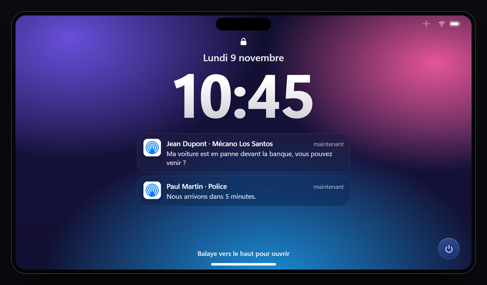 | 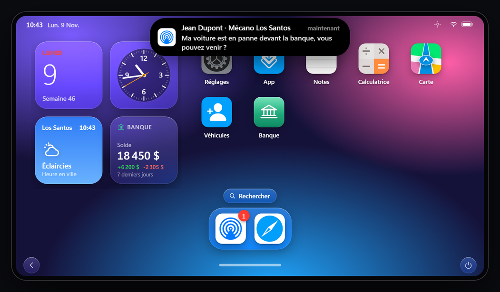 |
| **Centre de contrôle** | **Apps récentes** |
| 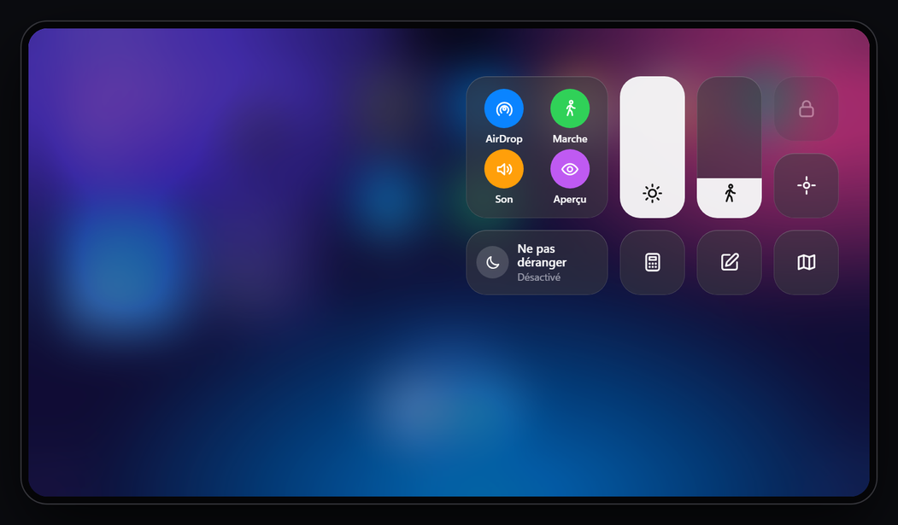 | 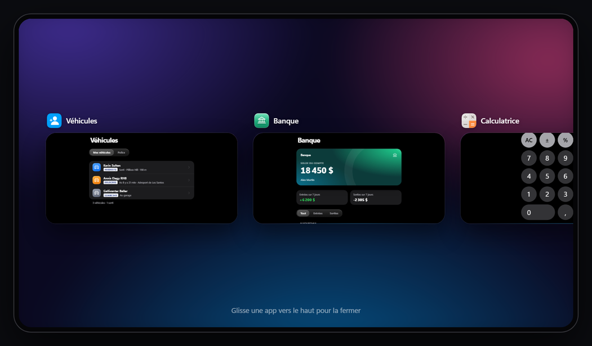 |
| **Recherche** | **Widgets** |
| 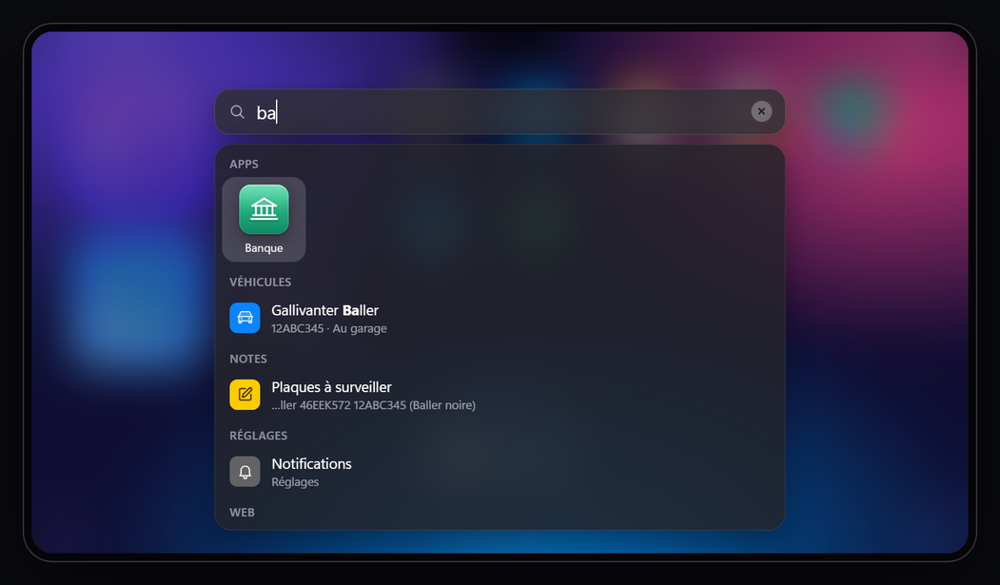 | 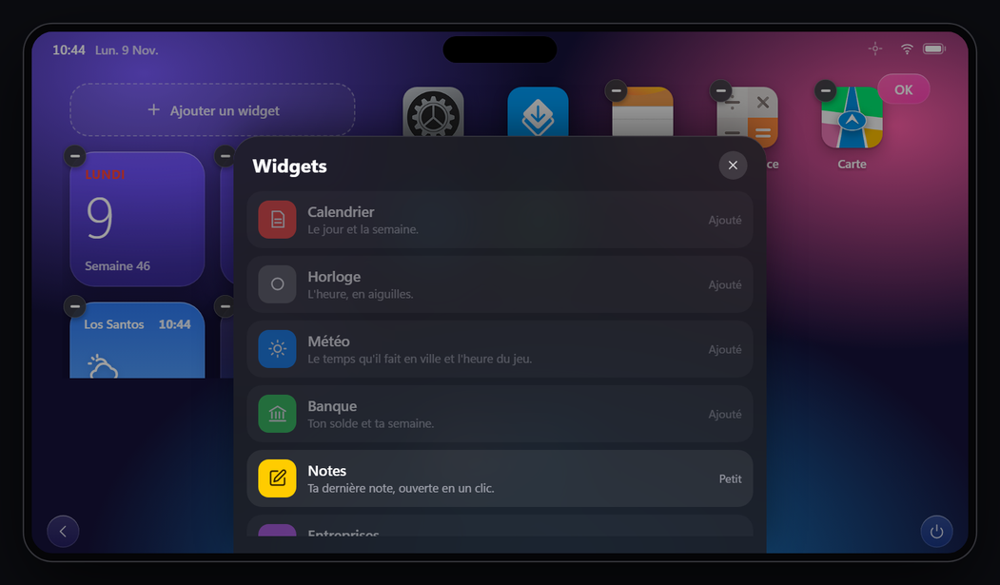 |
| **Carte** | **Véhicules** |
| 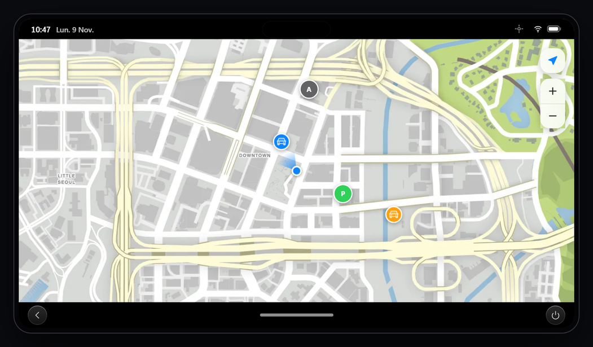 | 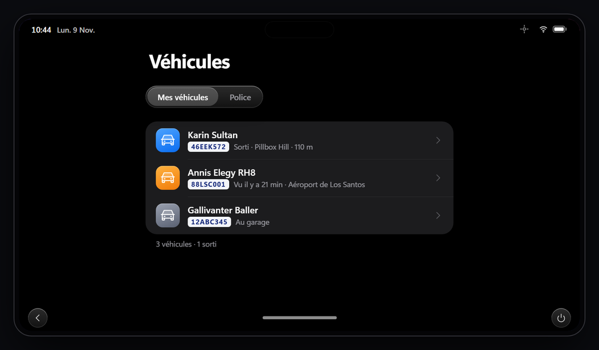 |
| **Banque** | **Services** |
| 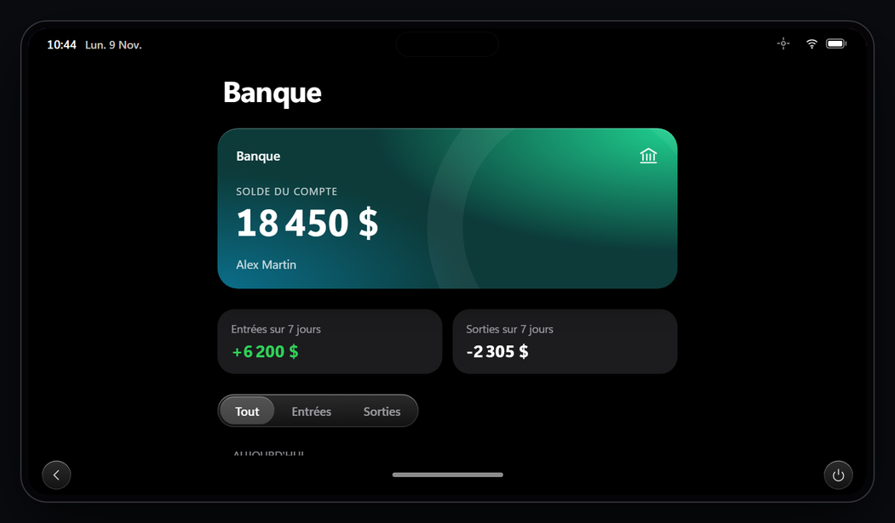 | 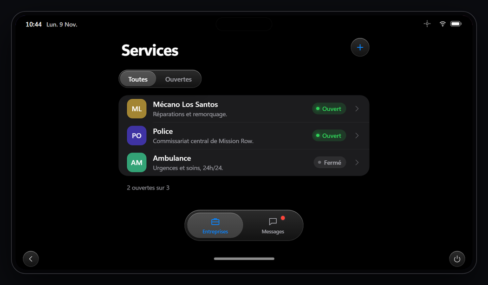 |
| **Notes** | **App** |
| 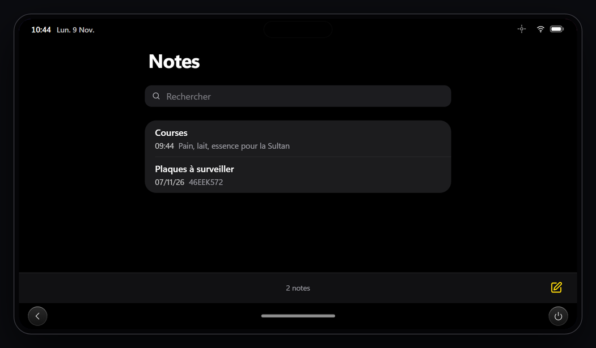 | 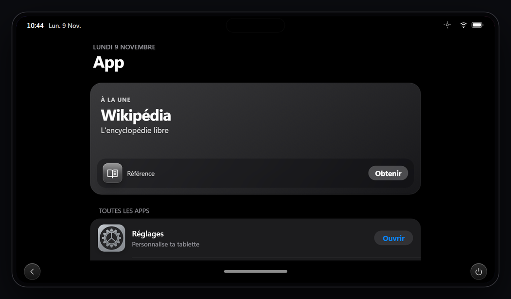 |
| **Réglages** | |
| 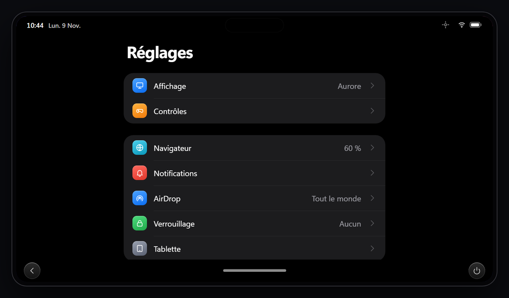 | |

---

## Fonctionnalités

### Les apps

| App | |
|---|---|
| **Navigateur** | Onglets, favoris, zoom, liste blanche de sites. Deux modes : **Frame** (iframe, clavier natif) et **Rendu** (navigateur interne dessiné en jeu, pour les sites qui refusent l'iframe). Le serveur détecte tout seul le bon mode. |
| **App** | La boutique : les apps web du serveur (`Config.Store`) s'installent et s'ouvrent en plein écran, sans barre d'adresse, comme de vraies apps. |
| **Services** | L'annuaire des entreprises (une entreprise = un job ESX) : qui est ouvert, leurs sites, et une messagerie client / entreprise avec partage de position. |
| **Notes** | Liste avec recherche, éditeur plein écran, enregistrement pendant la frappe. Les notes sont liées à la tablette (l'objet) et protégées par son verrou. |
| **Calculatrice** | Façon iOS : priorité des opérations, pourcentages, changement de signe. Le clavier du PC marche aussi. |
| **Carte** | L'atlas de GTA V en local, ta position et ton cap en direct, les entreprises de Services, rue et quartier d'un point, itinéraire GPS en un clic. |
| **Véhicules** | Carte grise de tes véhicules et de ceux de ton entreprise (`owned_vehicles` d'ESX) : modèle, plaque, état, position. Accès aux véhicules d'entreprise selon le grade. « Voir sur la carte » suit le véhicule en direct. |
| **Banque** | Solde du compte ESX, entrées et sorties sur 7 jours, historique jour par jour avec filtre. Consultation seule, aucun virement. |
| **Réglages** | Fond d'écran (dégradés ou image par lien), luminosité, horloge 24 h, contrôles, navigateur, notifications et son, AirDrop, verrouillage, réinitialisation. |

### Le système

| | |
|---|---|
| **Objet ox_inventory** | La tablette s'utilise depuis l'inventaire ou avec une touche (F3 par défaut). Le personnage la tient en main avec une animation. Chaque tablette a son numéro de série, son verrou et ses notes. |
| **Écran d'accueil** | Colonne de widgets, grille d'apps et dock. Appui long : les icônes tremblent, on les déplace entre la grille et le dock, le « − » supprime l'app. |
| **Widgets** | Calendrier, horloge, météo (temps et heure du jeu), banque, dernière note, entreprises ouvertes, véhicules. En mode édition : « − » pour retirer, « Ajouter un widget » pour la galerie, glisser pour réordonner. |
| **Centre de contrôle** | AirDrop, marche avec la tablette, son, aperçu tablette rangée, Ne pas déranger, curseurs de luminosité et d'opacité en marchant, verrouiller tout de suite, recentrer la fenêtre, raccourcis Calculatrice / Notes / Carte. |
| **Apps récentes** | Les apps ouvertes avec un aperçu de leur écran. Une carte glissée vers le haut ferme l'app. Gestes sur la barre du bas pour revenir à l'accueil ou passer à l'app précédente. |
| **Recherche** | Apps, notes, véhicules (plaque ou modèle), entreprises, pages des Réglages, actions rapides (Ne pas déranger, verrouiller, son, nouvelle note...), calculs (`12*3+4`) et sites autorisés. Flèches et Entrée au clavier. |
| **Verrouillage** | Aucun, code à 4 chiffres ou Face ID (le code sert de secours). Lié à l'objet : chaque tablette a son propre verrou. Face ID refusé si le personnage porte un masque. |
| **Îlot et notifications** | Les notifications sortent de l'îlot en haut de l'écran. Tablette rangée, l'écran verrouillé dépasse un instant en bas de l'écran pour montrer la notification. Centre de notifications, pastilles rouges, glisser pour effacer. |
| **Ne pas déranger** | Les notifications arrivent en silence dans le centre : ni bannière, ni aperçu, ni son. Une lune s'affiche dans la barre d'état. |
| **AirDrop** | Partager une note ou une position avec une tablette à quelques mètres. Le destinataire accepte ou refuse ; la réception se coupe dans les Réglages ou le centre de contrôle. |
| **Marche** | On peut marcher tablette ouverte : elle devient translucide quand le personnage bouge. Opacité réglable. |
| **Fenêtre** | La tablette se déplace par la barre d'état et se redimensionne par les bords. En fenêtre étroite, la mise en page se compacte. |

---

## Installation

### 1. Dépendances

| Ressource | |
|---|---|
| [es_extended](https://github.com/esx-framework/esx_core) | ESX Legacy (testé avec la 1.16.3). |
| [ox_inventory](https://github.com/overextended/ox_inventory) | L'objet tablette et ses métadonnées. |
| [oxmysql](https://github.com/overextended/oxmysql) | Base de données. |
| OneSync | Positions des véhicules et AirDrop. |
| `cd_easytime` | **Facultatif.** Météo du widget. Sans lui, la météo est lue directement dans le jeu. |

### 2. Copier la ressource

Placer le dossier `rz-tablet` dans `resources/` puis l'ajouter au `server.cfg`, **après** ses dépendances :

```cfg
ensure oxmysql
ensure es_extended
ensure ox_inventory
ensure rz-tablet
```

### 3. Déclarer l'objet

Dans `ox_inventory/data/items.lua` :

```lua
['tablet'] = {
    label = 'Tablette',
    weight = 500,
    stack = false,
    close = true,
    consume = 0,
    client = {
        event = 'rz-tablet:open',
    },
},
```

> `stack = false` est indispensable : chaque tablette garde son numéro de série, son verrou et ses notes dans ses métadonnées.

### 4. Base de données

Rien à importer : les tables sont créées au premier démarrage (voir [Base de données](#base-de-données)).

### 5. Donner une tablette

```
/giveitem <id> tablet 1
```

---

## Configuration

Tout se règle dans [`config.lua`](config.lua), découpé en sections. Les réglages personnels (fond d'écran, luminosité, son, Ne pas déranger...) se font en jeu, dans l'app Réglages ou le centre de contrôle.

### Objet et ouverture

| Option | Défaut | Rôle |
|---|---|---|
| `Config.ItemName` | `'tablet'` | Nom de l'objet ox_inventory. |
| `Config.OpenKey` | `'F3'` | Touche d'ouverture. Chaque joueur peut la changer dans *Paramètres > Raccourcis > FiveM*. |
| `Config.DebugCommand` | `nil` | Nom d'une commande qui ouvre la tablette sans objet ni verrou (ex. `'tablet'`). Laisser `nil` en production. |
| `Config.Prop` | `prop_cs_tablet` | Modèle tenu en main, os et position. |
| `Config.Anim` | tablette (bus) | Animation pendant l'utilisation. |

### Marche

| Option | Défaut | Rôle |
|---|---|---|
| `Config.AllowWalk` | `true` | Autorise la marche tablette ouverte. `false` l'interdit pour tout le monde. |
| `Config.WalkOpacity` | `0.35` | Opacité par défaut quand le personnage marche (chaque joueur peut la changer). |

### Notifications

| Option | Défaut | Rôle |
|---|---|---|
| `Config.Notify.peek` | `true` | Tablette rangée : le haut de l'écran verrouillé dépasse en bas de l'écran avec la notification. Rien n'est cliquable tant que la tablette n'est pas sortie. |
| `Config.Notify.peekTime` | `5000` | Durée de l'aperçu (ms). |
| `Config.Notify.sound` | `true` | Petit son à la réception (chaque joueur peut le couper). |

### App (apps web)

Chaque entrée de `Config.Store` devient une app installable :

```lua
{
    id = 'dynasty8',                       -- unique : minuscules, chiffres, - et _
    label = 'Dynasty 8',
    subtitle = 'Immobilier à Los Santos',
    category = 'Immobilier',
    url = 'https://dynasty8wl.fr/',        -- https obligatoire
    color = '#0f8a4b',                     -- couleur du dégradé de l'icône
    icon = 'house-line',                   -- pictogramme Phosphor (voir ci-dessous)
    glyph = 'D8',                          -- lettres si pas d'icon
    image = nil,                           -- ou une image (https ou fichier de html/assets/icons/)
    description = 'Les biens à vendre et à louer.',
},
```

- **`icon`** : n'importe quel nom de [phosphoricons.com](https://phosphoricons.com) (ex. `car`, `shopping-cart`, `bank`, `police-car`). Les 1 512 pictogrammes sont fournis dans la ressource, rien n'est chargé depuis internet. La liste est aussi dans `dev/pictos.html`.
- Le site doit aussi figurer dans `Config.Browser.allowedHosts`.

### Icônes des apps

`Config.AppIcons` change l'icône de n'importe quelle app, y compris celles de base. La clé est l'id de l'app : `settings` (Réglages), `store` (App), `browser` (Navigateur), `services` (Services), `notes` (Notes), `calculator` (Calculatrice), `maps` (Carte), `vehicles` (Véhicules), `bank` (Banque), ou l'id d'une app web de `Config.Store`.

```lua
Config.AppIcons = {
    store    = 'https://exemple.com/icone.png',               -- image en ligne
    services = 'Services.jpg',                                -- image locale : html/assets/icons/Services.jpg
    settings = 'gear',                                        -- pictogramme Phosphor sur le dégradé d'origine
    browser  = { icon = 'globe', color = '#0a84ff' },         -- pictogramme + couleur du dégradé
}
```

- Une image remplit toute l'icône : prendre une image carrée, 128 px ou plus. Les coins sont arrondis automatiquement.
- Une image locale se dépose dans `html/assets/icons/` (png, jpg, jpeg ou webp) ; le nom ne doit contenir que des lettres, chiffres, `-` et `_`. Redémarrer la ressource après l'ajout.
- Si l'image ne charge pas ou si le pictogramme n'existe pas, l'app garde son icône d'origine.
- L'icône change partout : accueil, App, notifications, recherche, apps récentes.

### Notes

| Option | Défaut | Rôle |
|---|---|---|
| `Config.Notes.maxNotes` | `100` | Notes par tablette. |
| `Config.Notes.maxLength` | `4000` | Caractères par note. |

Les notes suivent l'objet : donner ou voler la tablette, c'est donner ses notes. Si elle est verrouillée, le serveur ne les envoie qu'une fois le code ou Face ID passé.

### Véhicules

| Option | Défaut | Rôle |
|---|---|---|
| `Config.Vehicles.jobs` | police et ambulance `{ see = 0, locate = 1 }`, mechanic et taxi `1` | Grade minimum par job pour voir les véhicules de l'entreprise (`see`) et les localiser (`locate`). Un nombre seul vaut pour les deux. Un job absent n'a pas d'onglet Entreprise. |
| `Config.Vehicles.needDuty` | `false` | Il faut être en service pour localiser les véhicules de l'entreprise. |
| `Config.Vehicles.registerCommand` | `'immatriculer'` | Commande staff pour tester sans concessionnaire ni garage, assis dans un véhicule : `/immatriculer` (à ton nom), `/immatriculer police` (à l'entreprise), `/immatriculer retirer`. `nil` la désactive. |

Mes véhicules = `owner` égal à l'identifiant du personnage. Véhicules d'entreprise = colonne `job` égale à ton job, ou `owner` égal à `society:<job>`. Un véhicule n'a de position que s'il existe dans le monde (OneSync). Sinon il est « Au garage » (`stored = 1`), ou on montre l'endroit où il a été vu pour la dernière fois (oublié au redémarrage de la ressource).

### Banque

| Option | Défaut | Rôle |
|---|---|---|
| `Config.Bank.account` | `'bank'` | Compte ESX affiché et suivi. |
| `Config.Bank.name` | `'Banque'` | Nom sur la carte du compte. |
| `Config.Bank.currency` | `'$'` | Symbole de la monnaie. |
| `Config.Bank.keepDays` | `60` | Opérations plus anciennes supprimées au démarrage (`0` = jamais). |

L'historique écoute les événements serveur d'ESX `esx:addAccountMoney`, `esx:removeAccountMoney` et `esx:setAccountMoney`. Il ne contient donc que les mouvements faits depuis l'installation, par un script qui passe par ESX. Le motif affiché est celui donné par ce script (les motifs d'ESX sont traduits : salaire, aide sociale...) ; sans motif, la ligne s'appelle « Virement reçu » ou « Paiement ».

### AirDrop

| Option | Défaut | Rôle |
|---|---|---|
| `Config.AirDrop.range` | `8.0` | Distance maximale entre les deux joueurs, en mètres. |
| `Config.AirDrop.expire` | `60` | Secondes pour accepter une demande. |
| `Config.AirDrop.cooldown` | `3000` | Délai entre deux envois d'un même joueur (ms). |
| `Config.AirDrop.showNames` | `true` | Affiche « Prénom N. » ; `false` : « Tablette ». |

Le destinataire doit avoir une tablette sur lui et être dans le même monde (routing bucket). Tablette rangée, il reçoit une notification et la demande attend qu'il sorte et déverrouille sa tablette. Une note acceptée s'ajoute dans ses Notes, une position s'ouvre sur sa Carte.

### Navigateur

| Option | Défaut | Rôle |
|---|---|---|
| `restrictToAllowed` | `true` | N'autorise que les sites de `allowedHosts` (et leurs sous-domaines). |
| `allowedHosts` | `{ }` | Liste blanche des domaines. |
| `autoDetect` | `true` | Le serveur lit les en-têtes du site (`X-Frame-Options`, `Content-Security-Policy`) et choisit Frame ou Rendu. |
| `mode` | `'frame'` | Mode par défaut quand la détection ne répond pas. |
| `zoom` | `0.6` | Zoom par défaut des pages (60 %, rendu « grand écran »). |
| `home` / `search` | Wikipédia | Page d'accueil et moteur de recherche (`%s` = recherche). |
| `bookmarks` | `{ ... }` | Favoris par défaut. |

`Config.Dui` règle le mode Rendu : taille maximale et sens de la molette (`wheelScale`).

### Services

| Option | Défaut | Rôle |
|---|---|---|
| `staffGroups` | `owner`, `admin` | Groupes ESX qui peuvent ajouter, modifier ou supprimer des entreprises. L'ace `command` donne aussi le droit. |
| `messageCooldown` | `4000` | Délai entre deux messages d'un même joueur (ms). |
| `messageMaxLength` | `300` | Longueur maximale d'un message. |
| `maxMessagesPerService` | `500` | Messages conservés par entreprise. |
| `keepMessagesDays` | `7` | Suppression automatique des vieux messages. |

Une entreprise est **ouverte** quand au moins un joueur de son job est en service (`job.onDuty` différent de `false`).

---

## Utilisation en jeu

### Les bases

| Action | Comment |
|---|---|
| Ouvrir / fermer | Utiliser l'objet, ou **F3**. **Échap** ferme. |
| Déverrouiller | Balayer l'écran verrouillé vers le haut, puis taper le code (clavier ou pavé). Face ID se lance tout seul. |
| Revenir en arrière | La flèche en bas à gauche. |
| Déplacer la tablette | Glisser la barre d'état (en haut). Redimensionner par les bords. |
| Taper dans une page | Cliquer dans la page : le clavier passe du jeu à la tablette. |

### Gestes

| Geste | Où | Résultat |
|---|---|---|
| Clic, ou glisser vers le haut d'un coup | Barre du bas | Accueil. |
| Glisser vers le haut et marquer une pause, ou appui long | Barre du bas | Apps récentes. |
| Glisser à gauche ou à droite | Barre du bas | App précédente. |
| Glisser une carte vers le haut | Apps récentes | Ferme l'app. |
| Glisser vers le bas | Accueil | Recherche (ou la pastille « Rechercher »). |
| Clic sur le wifi / la batterie, ou glisser vers le bas | Droite de la barre d'état | Centre de contrôle. |
| Clic | Îlot | Centre de notifications. |
| Glisser une carte sur le côté | Notifications | Efface la notification. |
| Appui long | Icône ou widget | Mode édition : déplacer, supprimer, ajouter un widget. **OK**, un clic dans le vide ou Échap pour terminer. |

Une app supprimée se réinstalle depuis **App**.

---

## Pour les développeurs

### Envoyer une notification

Depuis n'importe quelle ressource.

**Client :**

```lua
exports['rz-tablet']:Notify({
    app = 'system',          -- id d'une app (services, settings, store, notes, bank... ou une app web)
    title = 'Titre',
    body = 'Texte de la notification',
})
```

**Serveur :**

```lua
TriggerClientEvent('rz-tablet:notify', playerId, {
    app = 'system',
    title = 'Titre',
    body = 'Texte de la notification',
})
```

- Tablette ouverte : la notification sort de l'îlot.
- Tablette rangée (mais dans l'inventaire) : aperçu de l'écran verrouillé en bas de l'écran, non cliquable.
- Pas de tablette sur soi : simple notification ESX.
- Ne pas déranger activé : la notification va directement dans le centre, sans bannière ni son.

Le champ optionnel `open` dit quoi ouvrir au clic. Pour une conversation Services : `{ view = 'services', tid = ..., role = 'client' | 'company', serviceId = ..., service = '...', name = '...' }`.

### Ouvrir la tablette par code

```lua
TriggerEvent('rz-tablet:open', nil, { slot = slotNumber })   -- client
```

Sans `slot`, la tablette s'ouvre sans verrou.

### Ajouter une app

- **App web** : une entrée dans `Config.Store`, rien d'autre.
- **App intégrée** :
  1. une `<section class="view" id="mon-app">` dans `html/index.html` ;
  2. son module dans `html/js/`, son style dans `html/css/` (déclarés dans `index.html` et `fxmanifest.lua`) ;
  3. une entrée dans `BUILTIN` de `html/js/home.js` (icône dans `GLYPH`).

  Le module s'enregistre avec `RZ.registerView('mon-app', { enter, leave, back })` : `back()` renvoie `true` s'il a géré le retour (page interne). Une nouvelle app intégrée s'installe toute seule, une fois, sur les tablettes existantes, et apparaît d'elle-même dans la recherche et les apps récentes.

### Ajouter un widget

Dans `html/js/widgets.js` : une entrée dans `CATALOG` (nom, description, `wide` pour un widget large, pictogramme et teinte de la galerie), son rendu, et si besoin un chargeur dans `LOADERS` pour les données. Son style va dans `html/css/widgets.css`. Il apparaît alors dans la galerie.

### Échanges entre Lua et l'interface

| Sens | Nom | Fichier |
|---|---|---|
| Lua vers NUI | `open`, `close`, `walking`, `notify`, `svcIncoming` | `client/main.lua`, `client/notify.lua`, `client/services.lua` |
| Lua vers NUI | `bankChanged`, `airdrop`, `airdropResult`, `airdropCancel` | `client/bank.lua`, `client/airdrop.lua` |
| NUI vers Lua | `close`, `settings`, `typing`, `canFrame` | `client/main.lua` |
| NUI vers Lua | `duiLoad`, `duiStop`, `duiLayout`, `duiMouse`, `duiKey` | `client/dui.lua` (mode Rendu) |
| NUI vers Lua | `lockVerify`, `lockSet` | `client/lock.lua` |
| NUI vers Lua | `svc`, `svcWaypoint` | `client/services.lua` |
| NUI vers Lua | `notes` | `client/notes.lua` |
| NUI vers Lua | `mapPos`, `mapInfo`, `mapWaypoint` | `client/map.lua` |
| NUI vers Lua | `veh` (`list`, `positions`) | `client/vehicles.lua` |
| NUI vers Lua | `bank` | `client/bank.lua` |
| NUI vers Lua | `airdrop` (`nearby`, `send`, `answer`) | `client/airdrop.lua` |
| NUI vers Lua | `gameInfo` (météo et heure du jeu) | `client/widgets.lua` |

Les messages Lua vers NUI sont reçus dans `html/js/app/main.js`. Les vérifications sensibles (code, droits staff, messages, notes d'une tablette verrouillée) sont faites côté serveur, par des callbacks ESX `rz-tablet:*`.

### Côté interface

Les fichiers de `html/js/app/` partagent une même portée (l'ordre de chargement compte) et exposent `window.RZ` : `post`, `postJson`, `showView`, `registerView`, `openApp`, `closeApp`, `openUrl`, `getSetting`, `setSetting`, `setDnd`, `openSettings`... Les autres modules sont autonomes et se parlent par `window.RZ` et leur propre objet (`RZHome`, `RZWidgets`, `RZSwitch`, `RZSearch`, `RZCC`, `RZLock`, `RZNotif`, `RZVeh`, `RZSvc`...).

---

## Banc d'essai hors du jeu

Le dossier `dev/` permet de voir et modifier l'interface dans Chrome, sans lancer FiveM ni redémarrer la ressource.

1. Double-cliquer sur **`dev/lancer.bat`** (Python 3 requis). La page `http://localhost:8787/dev/` s'ouvre.
2. Le panneau de gauche simule le jeu : ouvrir, fermer, choisir le verrou (code de démo **1234**), le résultat de Face ID (reconnu, masque, inconnu), envoyer des notifications, tablette rangée, marche, résolution d'écran.
3. Chaque sauvegarde d'un fichier de `html/` recharge la tablette. Le CSS est remplacé à chaud, sans perdre l'écran en cours.

Les apps web (`Config.Store`) et les icônes (`Config.AppIcons`) sont lues dans le vrai `config.lua`. Le reste de ce qui passe par le serveur utilise des données de démo (entreprises, messages, notes, véhicules, banque, météo), et le mode Rendu n'existe pas. Pour voir une vraie capture du jeu derrière la tablette, déposer une image dans `dev/fond.jpg`.

`python dev/serve.py 8790 --no-open` lance le banc sur un autre port sans ouvrir le navigateur.

---

## Structure du dossier

```
rz-tablet/
├── fxmanifest.lua
├── config.lua                 configuration (voir plus haut)
├── README.md
├── LICENSE                    licence MIT
│
├── client/
│   ├── main.lua               ouverture, fermeture, animation, marche, touche F3
│   ├── dui.lua                mode Rendu du navigateur (navigateur interne dessiné en jeu)
│   ├── lock.lua               verrouillage, détection du masque pour Face ID
│   ├── notify.lua             notifications (export Notify, événement rz-tablet:notify)
│   ├── services.lua           pont NUI <-> serveur pour Services
│   ├── notes.lua              pont NUI <-> serveur pour Notes
│   ├── map.lua                position, rues, point GPS pour la Carte
│   ├── vehicles.lua           noms des modèles, quartiers, commande /immatriculer
│   ├── bank.lua               pont NUI <-> serveur pour la Banque
│   ├── airdrop.lua            demandes AirDrop reçues et réponses
│   └── widgets.lua            météo (cd_easytime si présent) et heure du jeu
│
├── server/
│   ├── main.lua               config du navigateur, détection iframe autorisée ou non
│   ├── lock.lua               verrous par tablette (métadonnée rz_serial), état déverrouillé
│   ├── services.lua           entreprises, conversations, messages
│   ├── notes.lua              notes par tablette
│   ├── vehicles.lua           véhicules (owned_vehicles), droits par grade, positions (OneSync)
│   ├── bank.lua               historique des mouvements du compte ESX
│   └── airdrop.lua            tablettes à portée, demandes en attente
│
├── html/                      l'interface (NUI)
│   ├── index.html
│   ├── loading.html           page vide utilisée par le mode Rendu
│   ├── css/
│   │   ├── base.css           couleurs, verre, fenêtre, barres
│   │   ├── window.css         poignées, petites fenêtres
│   │   ├── home.css           accueil, icônes, dock
│   │   ├── home-edit.css      mode édition de l'accueil
│   │   ├── widgets.css        widgets, galerie, pastille Rechercher
│   │   ├── cc.css             centre de contrôle, voile de luminosité
│   │   ├── switcher.css       apps récentes
│   │   ├── search.css         recherche
│   │   ├── lock.css           verrouillage
│   │   ├── notify.css         îlot, notifications, aperçu tablette rangée
│   │   ├── browser.css        navigateur, apps web plein écran
│   │   ├── store.css          App
│   │   ├── services.css       Services
│   │   ├── notes.css          Notes
│   │   ├── calc.css           Calculatrice
│   │   ├── map.css            Carte
│   │   ├── vehicles.css       Véhicules
│   │   ├── bank.css           Banque
│   │   ├── airdrop.css        AirDrop
│   │   ├── settings.css       Réglages
│   │   └── preferences.css    survol, mouvement réduit, transparence réduite
│   ├── js/
│   │   ├── app/               le socle (portée partagée, l'ordre compte)
│   │   │   ├── core.js        appels Lua, stockage, réglages, horloge, vues
│   │   │   ├── browser.js     navigateur, apps web plein écran
│   │   │   ├── window.js      fenêtre déplaçable / redimensionnable
│   │   │   ├── settings.js    Réglages
│   │   │   └── main.js        barre du bas, messages Lua, window.RZ
│   │   ├── home.js            accueil, icônes, mode édition (RZHome)
│   │   ├── widgets.js         widgets de l'accueil (RZWidgets)
│   │   ├── cc.js              centre de contrôle (RZCC)
│   │   ├── switcher.js        apps récentes, gestes de la barre du bas (RZSwitch)
│   │   ├── search.js          recherche (RZSearch)
│   │   ├── lock.js            verrouillage (RZLock)
│   │   ├── notify.js          îlot et notifications (RZNotif, RZIsland)
│   │   ├── store.js           App (RZStore)
│   │   ├── services.js        Services (RZSvc)
│   │   ├── notes.js           Notes (RZNotes)
│   │   ├── calc.js            Calculatrice
│   │   ├── map.js             Carte (calage coordonnées du jeu -> atlas en tête du fichier)
│   │   ├── vehicles.js        Véhicules (RZVeh)
│   │   ├── bank.js            Banque (RZBank)
│   │   └── airdrop.js         AirDrop (RZDrop)
│   └── assets/
│       ├── icons/             Phosphor Duotone (duotone.json) et images locales pour Config.AppIcons
│       ├── map/               atlas de GTA V en tuiles webp 512 px (zoom 0 à 4)
│       └── leaflet/           Leaflet 1.9.4 (affichage de la carte)
│
├── dev/                       banc d'essai hors jeu
│   ├── lancer.bat
│   ├── serve.py
│   ├── index.html             panneau de contrôle
│   ├── pictos.html            les 1 512 pictogrammes, clic = nom copié
│   └── icones.html            comparaison des styles d'icônes
│
└── docs/                      captures du README
```

Seuls les fichiers listés dans `fxmanifest.lua` sont envoyés aux joueurs : `dev/`, `docs/` et ce README restent sur le serveur.

---

## Base de données

Les tables sont créées et mises à jour automatiquement au démarrage par oxmysql.

| Table | Contenu |
|---|---|
| `rz_tablet_locks` | Verrou de chaque tablette : numéro de série, propriétaire, mode, empreinte du code (jamais le code en clair). |
| `rz_tablet_notes` | Notes : numéro de série de la tablette, texte, date de modification. |
| `rz_tablet_services` | Entreprises : nom, job ESX, description, site, image, position. |
| `rz_tablet_service_messages` | Messages des conversations (client, entreprise, positions partagées). Nettoyés après `keepMessagesDays`. |
| `rz_tablet_bank_log` | Mouvements du compte : identifiant du personnage, montant (négatif = sortie), solde après, motif, date. Nettoyés après `keepDays`. |
| `owned_vehicles` | Table d'ESX, lue par l'app Véhicules (écrite seulement par `/immatriculer`). |

Le numéro de série de chaque tablette est stocké dans ses métadonnées ox_inventory (`rz_serial`). Les réglages personnels (fond, widgets, disposition de l'accueil, luminosité...) restent dans le stockage local de l'interface, sur le PC du joueur.

---

## Dépannage

**Une page reste blanche dans le navigateur.**
Le site interdit l'affichage en iframe. Avec `autoDetect = true`, il passe en mode Rendu tout seul. Sinon, utiliser le bouton **Frame / Rendu** dans la barre du navigateur (ou **Mode rendu** dans l'aide qui s'affiche). Le choix est retenu par site et se retire dans *Réglages > Navigateur*. Pour ton propre site, autorise la tablette avec l'en-tête :

```
Content-Security-Policy: frame-ancestors 'self' https://cfx-nui-rz-tablet nui://rz-tablet
```

**On ne peut pas écrire dans une page.**
Le mode Rendu n'a pas de clavier. Il faut que le site accepte le mode Frame.

**F3 ne fait rien.**
Une autre ressource utilise peut-être déjà la touche. Changer `Config.OpenKey`, ou la touche dans *Paramètres > Raccourcis > FiveM*.

**Face ID ne marche pas.**
Le personnage porte un masque : il faut retirer le masque, ou taper le code.

**Les entreprises n'apparaissent pas.**
Un membre du staff (`staffGroups`) doit les ajouter avec le bouton **+** dans Services. Chaque entreprise est liée à un job ESX existant.

**La Banque est vide.**
L'historique commence à l'installation et ne voit que les mouvements passés par ESX. Le solde, lui, est toujours juste.

**Un véhicule n'a pas de position.**
Il n'existe pas dans le monde (au garage, ou pas sorti depuis le redémarrage). Pour l'entreprise, la position n'est visible qu'à partir du grade `locate`.

**Pas de son, pas de bannière.**
Ne pas déranger est peut-être activé (lune dans la barre d'état), ou le son est coupé dans le centre de contrôle.

**L'écran est sombre.**
La luminosité se règle dans le centre de contrôle ou *Réglages > Affichage*.

---

## Crédits et licences

- Pictogrammes : [Phosphor Icons](https://phosphoricons.com), licence MIT (`html/assets/icons/LICENSE-phosphor.txt`).
- Carte : [Leaflet](https://leafletjs.com) 1.9.4, licence BSD-2 (`html/assets/leaflet/LICENSE-leaflet.txt`).
- Atlas de la carte : « GTA V UHD Map » 8192 px de [bragitoff.com](https://www.bragitoff.com/2015/11/gta-v-maps-quad-ultra-high-definition-8k-quality/), d'après la carte du jeu © Rockstar Games.
- Images de comparaison dans `dev/icones/` : [Microsoft Fluent Emoji](https://github.com/microsoft/fluentui-emoji), licence MIT.
- Design inspiré d'iPadOS. Aucune ressource d'Apple n'est utilisée.

### Licence

Le code de rz-tablet est sous licence [MIT](LICENSE) : libre de l'utiliser, le modifier et le partager, en gardant la mention de copyright.

Les ressources tierces listées ci-dessus gardent leur propre licence. L'atlas de la carte et tout ce qui vient de GTA V restent la propriété de leurs auteurs et de Rockstar Games.
